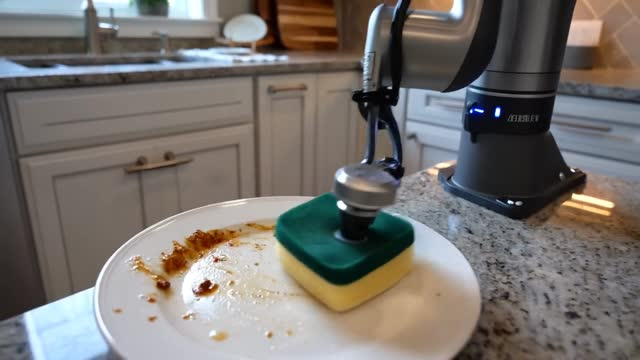

# dgx-spark-physical-ai

Setting up a physical-AI workstation on an **NVIDIA DGX Spark–class machine** (Lenovo ThinkStation
PGX, GB10 Grace Blackwell, aarch64, 128 GB unified memory): **Isaac Sim 6.1**, **Isaac Lab 3.0.0-EA**
and **Cosmos3-Nano**, with everything (environments, model weights, caches) kept on an external SSD.

Everything below was run and measured on the real machine on 2026-10-18/19.

## Results at a glance

| What | Result |
| --- | --- |
| Isaac Sim 6.1 + Isaac Lab v3.0.0-EA install (`uv sync --extra isaacsim`) | 438 packages, 20 min, no source build of Isaac Sim needed |
| Isaac Lab smoke test (Cartpole-Direct, PhysX, rsl_rl, 20 iterations, headless) | Passes, mean reward −0.11 → 1.67, 0.17 s/iteration |
| Cosmos3-Nano text-to-video, 720×1280, 189 frames, 35 steps (official setting) | **32 min 43 s**, peak 45.1 GB GPU allocation, 66 GB system memory |
| Cosmos3-Nano text-to-video, 480×832, 33 frames, 35 steps | 2 min 19 s, 37.7 GB |

Full numbers: [wiki/runbooks/cosmos3-nano.md](wiki/runbooks/cosmos3-nano.md).



## Environment

| Item | Version |
| --- | --- |
| OS | DGX OS 7.2.3 (Ubuntu 24.04.5 LTS, arm64) |
| GPU driver / CUDA | 580.178.04 / CUDA 13.0 |
| Isaac Lab | v3.0.0-EA (Python 3.12, torch 2.11.0+cu130, isaacsim 6.1.0.0) |
| Cosmos | Cosmos3-Nano (16B, BF16), diffusers 0.41.0.dev0, torch 2.14.1+cu130, Python 3.13 |
| Storage | Internal 1 TB NVMe (OS) + external 2 TB USB SSD (ext4) at `/mnt/ssd` |

## Quick start

```bash
# 1. external SSD (sudo)
./scripts/mount-ssd.sh /dev/sda1
# 2. send every cache to the SSD
./scripts/link-caches-to-ssd.sh
# 3. Isaac Sim + Isaac Lab (needs the apt packages listed in the script header)
./scripts/install-isaaclab.sh
source /mnt/ssd/isaac/env.sh
uv run --extra isaacsim isaaclab train --rl_library rsl_rl \
  --task Isaac-Cartpole-Direct physics=isaacsim_physx agent.max_iterations=20
# 4. Cosmos3-Nano (needs a Hugging Face token and the model license accepted)
./scripts/cosmos/setup-cosmos.sh
cd /mnt/ssd/cosmos && .venv/bin/python /path/to/scripts/cosmos/t2v_multi.py 480,832,33,35
```

## Layout

```
scripts/        setup scripts (SSD mount, cache links, Isaac Lab install, Cosmos setup, env.sh)
docs/images/    screenshots and frames
docs/logs/      raw output from the runs the numbers come from
wiki/           knowledge base: runbooks, decisions, lessons, research, open issues, work log
```

Start with the [wiki index](wiki/index.md).

## Gotchas worth knowing up front

- Isaac Sim on aarch64 will not start without `LD_PRELOAD=/lib/aarch64-linux-gnu/libgomp.so.1`.
- Isaac Lab 3.0 has a new Hydra CLI: no `--headless` (headless is the default), use overrides such as
  `agent.max_iterations=20`, and `--viz kit|newton|viser` to see something.
- An x86_64 Isaac Sim build cannot be reused on this machine, even from the same SSD.
- Not supported on DGX Spark by Isaac Lab: SkillGen, XR teleoperation, livestream, Hub Workstation
  Cache, Cosmos Transfer1, RLinf. See [the issue page](wiki/issues/spark-unsupported-features.md).
